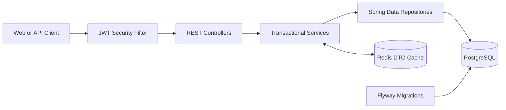

<div align="center">

<h1>Spring E-commerce API</h1>

<p><strong>A production-oriented e-commerce backend portfolio project built with Java 21 and Spring Boot 4.</strong></p>

<p>
  <a href="https://github.com/ooam-iroo/Spring-Ecommerce-API"></a>
  <a href="https://github.com/ooam-iroo/Spring-Ecommerce-API/actions/workflows/ci.yml"></a>
  
  
  
  
  
</p>

<p>
  <a href="#quick-start">Quick start</a> ·
  <a href="#api-documentation">Swagger</a> ·
  <a href="#architecture">Architecture</a> ·
  <a href="#testing">Testing</a>
</p>

</div>

> **Portfolio note:** This README distinguishes implemented features from checks that still require a successful external Docker or GitHub Actions run.

## At a glance

| Capability | Implementation |
|---|---|
| Authentication | Stateless JWT, BCrypt passwords, method security |
| Authorization | User/admin role-based access control |
| Catalog | Products, categories, filtering, pagination |
| Commerce | Cart, orders, payments, reviews, addresses |
| Administration | User, product, category, order, dashboard APIs |
| Persistence | PostgreSQL, JPA/Hibernate, Flyway |
| Performance | Redis DTO caching and mutation invalidation |
| Quality | Unit, MockMvc, admin, and Testcontainers tests |
| Delivery | Multi-stage Docker image, Compose, GitHub Actions |

## Contents

- [Features](#features)
- [Technology](#technology)
- [Architecture](#architecture)
- [Quick start](#quick-start)
- [Configuration](#configuration)
- [API documentation](#api-documentation)
- [Authentication](#authentication)
- [API surface](#api-surface)
- [Error contract](#error-contract)
- [Testing](#testing)
- [Operations and deployment](#operations-and-deployment)
- [CI](#ci)
- [Verification status](#verification-status)

## Features

<table>
<tr><td>🔐 <strong>Security</strong></td><td>JWT authentication, BCrypt, stateless sessions, method-level authorization, admin-only operations</td></tr>
<tr><td>🛍️ <strong>Commerce</strong></td><td>Catalog browsing, cart management, order lifecycle, payment/refund flow, product reviews</td></tr>
<tr><td>⚡ <strong>Caching</strong></td><td>Redis-backed product and category DTO caches with invalidation on mutations</td></tr>
<tr><td>🧪 <strong>Testing</strong></td><td>JUnit 5, Mockito, MockMvc, PostgreSQL and Redis Testcontainers</td></tr>
<tr><td>📚 <strong>Documentation</strong></td><td>OpenAPI 3, Swagger UI, examples, environment reference, Docker and CI instructions</td></tr>
</table>

## Technology

<p>
  
  
  
  
  
  
</p>

## Architecture



The codebase uses a conventional layered architecture:

```text
com.example.ecommerce
├── config          Security, Redis, cache, auditing, OpenAPI, request filters
├── controller      Public and admin HTTP endpoints
├── dto             Request and response contracts
├── entity          JPA entities and domain state
├── exception       Error contract and global exception handling
├── repository      Data access and product specifications
├── security        JWT validation and authenticated-user support
└── service         Business rules and transaction boundaries
```

PostgreSQL is the source of truth. Redis stores serialized response DTOs rather than managed JPA entities. Product and category mutations invalidate affected read caches, including filtered and paginated product results.

## Quick start

### Prerequisites

- JDK 21
- Docker Engine/Desktop with Compose
- Maven 3.9+ or the included Maven Wrapper
- Docker access for Testcontainers tests

### Start the complete local stack

```bash
docker compose up --build
```

Services:

| Service | Address | Purpose |
|---|---|---|
| API | `http://localhost:8080` | Spring Boot application |
| Swagger | `http://localhost:8080/swagger-ui.html` | Interactive API docs |
| PostgreSQL | `localhost:5432` | Persistent relational data |
| Redis | `localhost:6379` | Cache and health contributor |

Stop services:

```bash
docker compose down
```

Use `docker compose down -v` only when intentionally deleting local data volumes.

### Run the API outside Docker

```bash
docker compose up -d postgres redis
./mvnw spring-boot:run
```

## Configuration

Local defaults are development-only. Supply production values through the environment:

| Variable | Description | Local default |
|---|---|---|
| `SPRING_DATASOURCE_URL` | PostgreSQL JDBC URL | `jdbc:postgresql://localhost:5432/ecommerce` |
| `SPRING_DATASOURCE_USERNAME` | Database username | `ecommerce` |
| `SPRING_DATASOURCE_PASSWORD` | Database password | `ecommerce` |
| `REDIS_HOST` | Redis hostname | `localhost` |
| `REDIS_PORT` | Redis port | `6379` |
| `JWT_SECRET` | JWT signing secret; use 32+ characters | Development placeholder |
| `SPRING_PROFILES_ACTIVE` | Optional active profile | unset |

Never commit real credentials, JWT secrets, `.env` files, or access tokens.

## API documentation

| Resource | URL |
|---|---|
| Swagger UI | [`/swagger-ui.html`](http://localhost:8080/swagger-ui.html) |
| OpenAPI JSON | [`/v3/api-docs`](http://localhost:8080/v3/api-docs) |
| OpenAPI YAML | [`/v3/api-docs.yaml`](http://localhost:8080/v3/api-docs.yaml) |
| Health | [`/actuator/health`](http://localhost:8080/actuator/health) |

Swagger is configured with JWT Bearer authentication. Select **Authorize** and enter `Bearer <access-token>`.

## Authentication

Register and log in:

```bash
curl -X POST http://localhost:8080/api/v1/auth/register \
  -H 'Content-Type: application/json' \
  -d '{"name":"Ada Lovelace","email":"ada@example.com","password":"StrongPassword123"}'

curl -X POST http://localhost:8080/api/v1/auth/login \
  -H 'Content-Type: application/json' \
  -d '{"email":"ada@example.com","password":"StrongPassword123"}'
```

Call a protected endpoint:

```bash
curl http://localhost:8080/api/v1/cart \
  -H 'Authorization: Bearer <access-token>'
```

## API surface

| Domain | Base path | Access |
|---|---|---|
| Authentication | `/api/v1/auth` | Public |
| Products | `/api/v1/products` | Public reads; authenticated mutations |
| Categories | `/api/v1/categories` | Public reads; authenticated mutations |
| Cart | `/api/v1/cart` | Authenticated user |
| Orders | `/api/v1/orders` | Authenticated user |
| Payments | `/api/v1/orders/{orderId}/payment` | Authenticated user |
| Reviews | `/api/v1/products/{productId}/reviews`, `/api/v1/reviews` | Authenticated user |
| Addresses | `/api/v1/users/{userId}/addresses` | Authenticated owner |
| Admin users | `/api/v1/admin/users` | Admin role |
| Admin products | `/api/v1/admin/products` | Admin role |
| Admin categories | `/api/v1/admin/categories` | Admin role |
| Admin orders | `/api/v1/admin/orders` | Admin role |
| Dashboard | `/api/v1/admin/dashboard` | Admin role |

Product listing supports name, category, status, minimum-price, maximum-price, pagination, and sorting parameters. Swagger is the authoritative source for exact schemas and parameter names.

## Error contract

```json
{
  "timestamp": "2026-10-20T12:00:00+02:00",
  "status": 400,
  "error": "VALIDATION_ERROR",
  "message": "Request validation failed",
  "path": "/api/v1/auth/register",
  "correlationId": "7d3c0e7e-7dc1-4ad0-96e7-4ed8f2d3c2ab",
  "fieldErrors": {"email": "must be a well-formed email address"}
}
```

The application handles resource-not-found, business, validation, malformed-request, data-integrity, endpoint-not-found, and unexpected internal errors. A valid `X-Correlation-Id` is accepted; otherwise one is generated, returned, and placed in the logging context for the request.

## Testing

```bash
# Full unit and integration suite
./mvnw test

# Redis/PostgreSQL Testcontainers class
./mvnw -Dtest=ProductCacheIntegrationTest test

# Compile/package without executing tests
./mvnw -DskipTests package
```

Testcontainers tests require a working Docker environment. Do not describe the full suite as green unless the exact command completes successfully.

## Operations and deployment

The Dockerfile uses a Maven Java 21 build stage and Java 21 JRE runtime stage. Compose configures health checks for PostgreSQL and Redis, service-name networking, startup dependencies, and named persistence volumes.

For production deployment, add a non-root runtime user, external secret management, image scanning, TLS/reverse proxy configuration, resource limits, backups, and network policies.

## CI

`.github/workflows/ci.yml` runs on pushes to `main`/`master` and pull requests. It configures Java 21 and Maven caching, then runs `./mvnw -B verify`. GitHub-hosted runners provide Docker for Testcontainers.

The workflow is configured in the repository; its success must be confirmed by an actual GitHub Actions run.

## Verification status

- Maven package build: verified with tests skipped.
- Swagger/OpenAPI dependency and application compilation: verified by package build.
- Unit and integration test suite: present, but the latest Redis cache run reported cache-population failures.
- Docker Compose end-to-end startup: not verified from this workspace.
- GitHub Actions execution: configured but not externally verified.

## License

No license has been declared yet. Add an appropriate license before public distribution.
